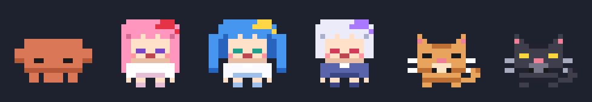
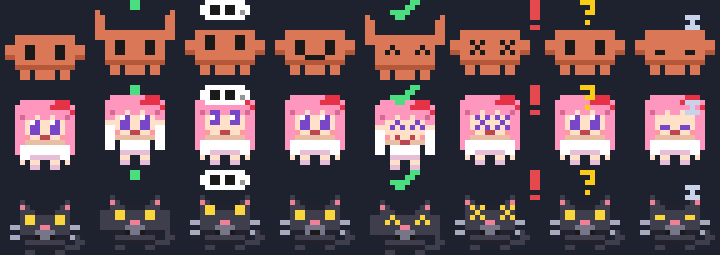

<div align="center">

# 🦀 voxcrab

**Голосовой маскот для ИИ-агентов: говори с сессиями [Claude Code](https://docs.anthropic.com/en/docs/claude-code), слушай короткие итоги и отвечай на вопросы голосом, пока на рабочем столе живёт пиксельный краб (или Live2D / VRM модель).**


[English](./README.md) · **Русский**



</div>

> Неофициальный проект, с Anthropic не связан. Речь обрабатывается на твоём компьютере (Vosk для слова активации, faster-whisper, голос Silero), в Claude Code уходит только текст задачи.

## Зачем

Сессии агента заканчиваются, просят разрешение или задают уточнение, пока ты смотришь в другое окно. `voxcrab` висит поверх экрана, одной фразой говорит, что произошло, задаёт вопрос вслух и отправляет твой голосовой ответ прямо в нужную сессию. Новую задачу тоже можно поставить голосом: «Клод, почини упавшие тесты в проекте X».

- 🎙️ **Без рук**: слово «Клод» (Vosk) или хоткей, определение паузы (Silero VAD), распознавание faster-whisper
- 🔊 **Отвечает голосом**: Silero TTS (русский), запасной вариант edge-tts. Числа, версии и латиница проговариваются словами перед синтезом, ничего не пропускается
- 🧩 **Подключается к Claude Code**: хуки из VS Code и CLI. `Stop` превращается в короткий пересказ, запросы разрешений и `AskUserQuestion` в голосовые вопросы
- 🧭 **Выбирает сессию по смыслу**: «в проекте с крабом добавь тест» уходит в подходящую живую сессию или открывает новую
- 🐾 **Персонажи**: встроенные пиксельные краб, коты, девочки и робот; свои GIF / PNG / спрайт-листы; **Live2D** (Cubism 3-5) и **VRM** (0.x / 1.0) в прозрачном окне поверх приложений; режим desktop pet
- 🎮 **Дружит с играми**: ничего не внедряет в чужие процессы, прячется в эксклюзивном полноэкранном режиме, держится поверх окон без рамки

## Как это работает

```
 ты ── голос ──▶  слово «Клод» / хоткей ─▶ VAD ─▶ Whisper ─▶ намерение (новая задача / ответ / «повтори» / «стоп»)
                                                              │
   сессии Claude Code ◀── messaging-сокет ◀── sidecar vscode_bridge (127.0.0.1, токен) ◀──┘
        │  хуки: SessionStart · Stop · PreToolUse(AskUserQuestion) · PermissionRequest
        ▼
   короткий итог / вопрос ─▶ Silero TTS ─▶ облачко и движение рта у маскота
```

Виджет сам поднимает небольшой sidecar, доступный только на loopback. Хуки Claude Code (`vscode_bridge/hook.py`, см. [`vscode_bridge/INSTALL.md`](vscode_bridge/INSTALL.md)) присылают ему события сессий.
Токены сессий лежат в `~/.voice-bridge` (права только текущего пользователя) и не попадают в логи. Голосовая задача маршрутизируется через `claude -p --model haiku` в живую сессию или открывает новую фоновую сессию, видимую в VS Code.

## Требования

- **Windows 10 / 11** (см. [Платформы](#платформы))
- Python 3.12 и микрофон
- Claude Code CLI (по желанию расширение для VS Code)
- около 3 ГБ на диске под модели при первом запуске; видеокарта NVIDIA ускоряет распознавание, но не обязательна
- Только для Live2D / VRM: Microsoft Edge WebView2 (в Windows 11 уже есть)

## Быстрый старт (Windows)

```bash
git clone https://github.com/skiddgoddamn/voxcrab.git
cd voxcrab
run.cmd            # первый запуск: создаст .venv и поставит зависимости; модели скачаются при старте
```

1. Модели (Whisper, Vosk, голос Silero) скачиваются в `models/` при первом запуске. В репозитории их **нет**.
2. Добавь хуки в `~/.claude/settings.json`: блок печатает `python vscode_bridge/gen_settings.py`.
3. Скажи **«Клод, привет»** или зажми `Ctrl+Alt+Space` и говори.
4. Правый клик по маскоту, затем **Настройки** (голос, хоткеи, персонажи, движки, режим окна).

Самопроверка: `python smoke.py`. Тесты: `python -m pytest tests_engines tests_settings tests_bridge`.

## Сборка для Windows

Теги `v*` собирает GitHub Actions ([`.github/workflows/build.yml`](.github/workflows/build.yml)): zip с приложением и установщик Inno Setup.
Локально: `pip install pyinstaller && python -m PyInstaller --noconfirm voice-widget.spec`, результат `dist/voice-widget/voice-widget.exe` (около 830 МБ, в основном torch).
Модели в сборку **не входят**: скачиваются при первом запуске в `%LOCALAPPDATA%\voice-widget\models`, там же настройки и `widget.log`. В собранной версии распознавание на CPU (библиотеки CUDA не включены; для GPU ставь из исходников).
Хукам Claude Code нужен системный Python (`python vscode_bridge/hook.py`, только стандартная библиотека).

## Голосовые команды

| Ты говоришь | Что происходит |
|---|---|
| «Клод, …задача…» | уходит в лучшую живую сессию или в новую |
| «Клод, что там» / «что нового» | озвучивает накопленное |
| «повтори», «ещё раз», «что?», «не расслышал» | повторяет последнюю озвученную фразу (сначала ожидающий вопрос) |
| «да» / «нет» / название варианта | отвечает на запрос разрешения или `AskUserQuestion` |
| «в новой сессии …» / «в проекте X …» | открывает новую сессию (по умолчанию или в названном проекте) |
| `Ctrl+Alt+X` | останавливает речь и прослушивание, сбрасывает ожидающий вопрос |
| `Ctrl+Alt+H` | показать / скрыть маскота |

Слово активации и язык распознавания сейчас русские; грамматика диалога лежит в `dialog_state.py` и `bridge_voice.py`.

## Запись встречи

`Ctrl+Alt+R` (трей, правый клик) включает и выключает **запись встречи**: микрофон и звук компьютера (WASAPI loopback устройства вывода по умолчанию через PyAudioWPatch, без виртуальных драйверов) сохраняются двумя дорожками (`mic.wav`, `others.wav`) и `mixed.flac` в `Documents\voxcrab\meetings\<дата-время>\` (папка настраивается). Во время записи слово «Клод» и все команды отключены, ничего не уходит в сессии, озвучка ждёт в очереди, у краба мигает красная точка.
После остановки локальный Whisper расшифровывает кусками с прогрессом и пишет `transcript.md` / `transcript.txt` с таймкодами и спикерами по источнику («Я» это микрофон, «Собеседники» это звук ПК), открывает файл и кладёт текст в буфер обмена. Claude получает текст только по клику «Отправить расшифровку Клоду…» в меню трея. При включённом «Не слушать» запись не стартует.

> **Приватность:** записывай звонки и встречи только с согласия всех, кого слышно. Записи не покидают компьютер, пока ты сам их не отправишь.

## Персонажи и движки

| Тип | Что это | Где |
|---|---|---|
| Встроенные пиксельные | краб, кот, робот, три девочки, три кота, нарисованы кодом (MIT) | [`characters.py`](characters.py) |
| Свои | GIF / кадры PNG / спрайт-листы по эмоциям (idle, listening, thinking, speaking, success, error, question, confirm, sleep) | [`characters/README.md`](characters/README.md) |
| Live2D | Cubism 3, 4 и 5 `.model3.json`, выражения, движения, моргание, рот по громкости речи | [`engines/README.md`](engines/README.md) |
| VRM | 0.x и 1.0, выражения, моргание, виземы, процедурное движение тела | [`engines/README.md`](engines/README.md) |



Импорт модели проверяет её, показывает лицензию, даёт предпросмотр и сохраняет в `%APPDATA%\voice-widget\characters`. Любая проблема отрисовки откатывает на стандартного персонажа с сообщением в облачке.

**Не входит в репозиторий, ты ставишь сам:** проприетарный **Live2D Cubism Core** (`live2dcubismcore.min.js`, скачай на live2d.com и укажи путь в настройках) и любые Live2D / VRM модели. Чужие модели и Core здесь не поставляются. См. [THIRD_PARTY.md](THIRD_PARTY.md).

## Настройка

`config.json` создаётся после первого изменения в настройках (он в `.gitignore`). Все ключи с значениями по умолчанию лежат в [`config.example.json`](config.example.json).
Главные: `hotkey`, `wake_word_enabled`, `speak_mode` (`immediate` или `on_request`), `whisper_model` (`auto`), `tts_speaker`, `tts_rate`, `mic_device`, `confirm_mode`, `bridge_enabled`, `bridge_hold`, `default_project_dir`, `character`, `window_mode` (normal или pet), `fullscreen_policy`, `click_through`, `render_fps`, `live2d_core_path`.

## Платформы

| ОС | Статус |
|---|---|
| Windows 10 / 11 | ✅ поддерживается и проверено |
| macOS, Linux | ❌ пока нет |

Основная логика (диалог, мост, нормализация текста для TTS, движок персонажей) это обычный Python. Только под Windows сейчас: глобальные хоткеи `keyboard`, прозрачность tkinter по цвету-ключу, вызовы Win32 через `ctypes` (`winmode.py`: определение полноэкранного режима, поверх всех окон, рабочая область), попиксельная прозрачность через `DwmExtendFrameIntoClientArea` и WebView2 в `engines/web_child.py`, запуск через `pythonw`, ACL папки моста. Для порта нужна замена каждому пункту.

## Ограничения

- Игры в эксклюзивном полноэкранном режиме DirectX скрывают любые оверлеи; используй режим окна без рамки.
- Слово активации и речь ориентированы на русский. «Клод» может ложно срабатывать от колонок, лучше наушники.
- Голоса Silero лицензированы **CC BY-NC-SA 4.0 (некоммерческая)** и скачиваются при запуске, а не входят в проект. Для коммерческого использования бери edge-tts или свой голос.
- DPI проверен на мониторе 125 %, на 150 % нет.

## Лицензия

MIT, см. [LICENSE](LICENSE). Вендорный JS (PixiJS, pixi-live2d-display, three.js, three-vrm) под MIT; скачиваемые модели и Python-зависимости сохраняют свои лицензии, см. [THIRD_PARTY.md](THIRD_PARTY.md).
